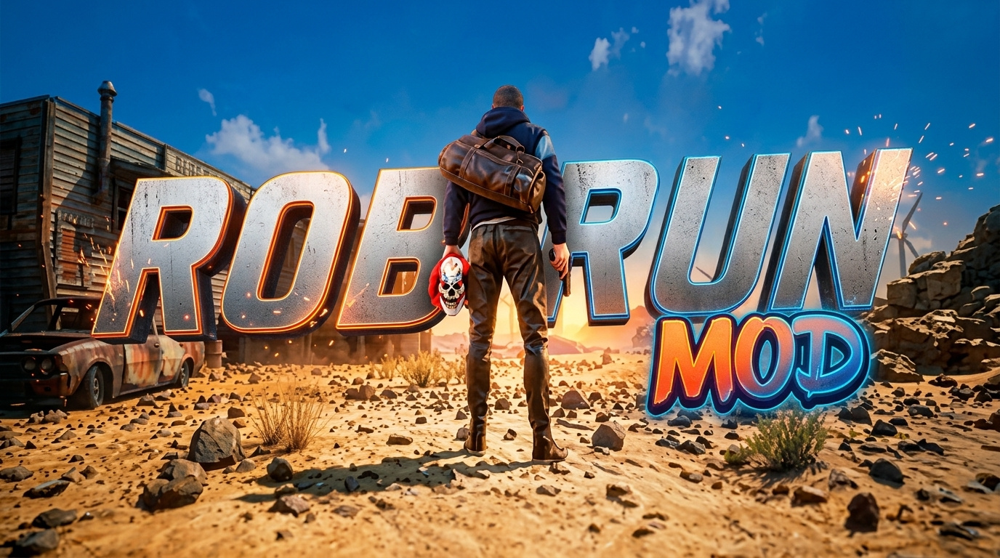

# 🏙️ ROB RUN: QoL Mods & Survival Guide Collection

  

  

  
  
  
  

  <b>⬇ DOWNLOAD THE QoL PACK ⬇</b>

  

  
  

  

> 🏙️ **Your complete toolkit for ROB RUN** — survival guides, QoL tweaks, and community tools for the brutal crime sandbox of Looty Bay. Designed for **private play and learning the game**. 🛡️ **NO CHEATS** — this repository contains no aimbots, ESP, or memory injection.

## 📖 About the Game

**ROB RUN** is a free-to-play, brutal crime sandbox MMO developed and published by **Kefir!** (the studio behind Rust). The game launched into **Steam Early Access on November 4, 2026**, and immediately pulled over **23,000 concurrent players**.

You are an escaped convict in the city of **Looty Bay**. Every cop and every criminal is a **real player** — there are no NPCs filling the world. With up to **5,000 players** sharing the same space, any situation can spiral out of control.

**Key Game Features**:
- 👥 **Only Real Players** — Every cop and criminal is a living human with their own agenda
- 🏴‍☠️ **Clans and Power** — Create a crime family, organize raids, wage gang wars
- ⚠️ **No Room for Error** — You risk losing everything every minute
- 🏠 **Your Home is Your Castle** — Build and upgrade your hideout, store loot and vehicles
- 🔄 **Weekly Server Wipes** — Every cycle resets the economy and your progress, but converts your wealth into status rewards

## ⚠️ IMPORTANT WARNING — READ BEFORE USING

**ROB RUN is an online multiplayer game protected by Easy Anti-Cheat (EAC).**

| Enforcement Risk | Details |
|------------------|---------|
| **Easy Anti-Cheat (EAC)** | Kernel-level anti-cheat installed on first launch |
| **Ban Risk** | **PERMANENT BAN** if detected using memory-editing tools |
| **This Repo** | Contains **NO CHEATS**. Only QoL guides, external tools, and community resources |

> 🚫 **DO NOT USE TRAINERS OR CHEATS.** ROB RUN has kernel-level EAC. Any memory injection will result in a permanent ban. This repository is strictly for **guides and external QoL tools** that do not interact with game memory.

## 🔒 Safety & Security

| Safety Feature | Description |
|----------------|-------------|
| **No Memory Injection** | This repo contains no DLLs, no trainers, no memory readers |
| **External Tools Only** | Guides, calculators, and community resources |
| **No Network Code** | No telemetry or online hooks |
| **Backup Recommended** | Always back up your account and game files |

## 🔥 Featured Content

### 📖 Looty Bay Survival Guide

**Source:** Community | **Type:** Guide

A comprehensive text guide covering the first 7 days in Looty Bay.

**What You'll Learn**:
- **Starting Out** — You arrive broke with only a duffel bag and a rented car
- **First Jobs** — Small stores and gas stations are the safest early targets
- **Progression** — Work up to safes, banks, and police armories
- **Gang Play** — Joining a clan is the fastest way into the game's actual content
- **Money Laundering** — Convert dirty cash to secure bank funds to protect your wealth

### 🎮 QoL Tweaks (External Only)

**Source:** Community | **Type:** Configuration

Safe, external configuration tweaks that do not interact with game memory.

**What's Available**:
- **Graphics Config** — Adjust settings beyond the in-game menu via config files
- **Keybind Optimization** — Community-recommended keybind layouts for heists and chases
- **Audio Tweaks** — Adjust footstep and gunshot audio levels for better awareness

> ⚠️ **Note**: These are **external configuration files only**. They do not inject code or read memory.

### 🧮 Heist Profit Calculator

**Source:** Community | **Type:** External Tool

A simple spreadsheet calculator for planning heists and tracking your weekly earnings.

**Features**:
- **Target Values** — Estimated loot value for each location type
- **Crew Split** — Calculate how much each gang member earns
- **Risk Assessment** — Compare potential loot vs. police response time

## 🚀 QUICK START

### Step 1 Install the Game

1. **Search** for ROB RUN on Steam (it's **free-to-play**)
2. **Install** the game and launch it once to install Easy Anti-Cheat
3. **Accept** the EULA and EAC prompt (required)

### Step 2 Start Small

1. **Arrive** in Looty Bay with nothing
2. **Learn** the city layout and watch how established crews operate
3. **Take** petty jobs and small robberies to build your first cash

### Step 3 Find a Crew

1. **Solo play works**, but heists and territory control go far better with a gang
2. **Join** an existing clan or create your own
3. **Assign** roles, organize raids, and start taking territory

## 📊 KEY FACTS

| Metric | Value |
|--------|-------|
| **Developer** | Kefir! |
| **Release Date** | November 4, 2026 (Early Access) |
| **Price** | Free-to-Play |
| **Anti-Cheat** | Easy Anti-Cheat (Kernel-level) |
| **Players** | 23,000+ concurrent at launch |
| **Server Size** | Up to 5,000 players per world |
| **Wipe Cycle** | Weekly |

## ❓ FAQ

### ❓ Is this a cheat or trainer?
**No.** This repository contains **NO CHEATS**. It is a collection of guides, external tools, and QoL resources. ROB RUN has kernel-level Easy Anti-Cheat, and any memory injection will result in a permanent ban.

### ❓ Will I get banned for using these guides?
**No.** Reading guides and using external calculators is completely safe. The game has no issue with players learning and planning outside the game.

### ❓ Is ROB RUN free?
**Yes.** The game is free-to-play on Steam.

### ❓ Does it work on Windows 11?
**Yes.** Fully compatible with Windows 10 and 11 (64-bit).

### ❓ How does the weekly wipe work?
Every week, the server resets. Your wealth is converted into **status rewards** (tattoos, cosmetics), but your inventory and cash are reset. This keeps the playing field level.

### ❓ Can I play solo?
**Yes.** But joining a clan is the fastest way to experience the game's real content (heists, territory wars).

### ❓ What are the system requirements?
Minimum: Intel Core i5-6600K, 12 GB RAM, GTX 1050 Ti. Recommended: Intel Core i5-9600K, 16 GB RAM, RTX 2070.

## 🛠️ System Requirements

| Component | Minimum | Recommended |
|-----------|---------|-------------|
| **OS** | Windows 10 (64-bit) | Windows 10/11 (64-bit) |
| **Processor** | Intel Core i5-6600K / AMD Ryzen R5 1600 | Intel Core i5-9600K / AMD Ryzen 5 3600 |
| **RAM** | 12 GB | 16 GB |
| **GPU** | NVIDIA GTX 1050 Ti / AMD RX 580 / Intel Arc A380 | NVIDIA RTX 2070 / AMD RX 5700 XT / Intel Arc B570 |
| **Storage** | 20 GB available space | 20 GB SSD |
| **Network** | Broadband Internet connection | Broadband Internet connection |

## 📢 Disclaimer

> **Fan-made guide collection.** Not affiliated with ROB RUN developers, Kefir!, or any publisher.
>
> **Use at your own risk.** The author is not responsible for account bans, data loss, or damage.
>
> **NO CHEATS** — this repository does not contain any memory-editing tools. ROB RUN uses kernel-level Easy Anti-Cheat.
>
> **Back up your account before use!**

## 🌟 Support This Project

- ⭐ **Star** this repository
- 🔔 **Watch** for updates
- 🐞 **Report** issues
- 💬 **Share** with friends!

© 2026 • ROB RUN • QoL & Survival Guide
